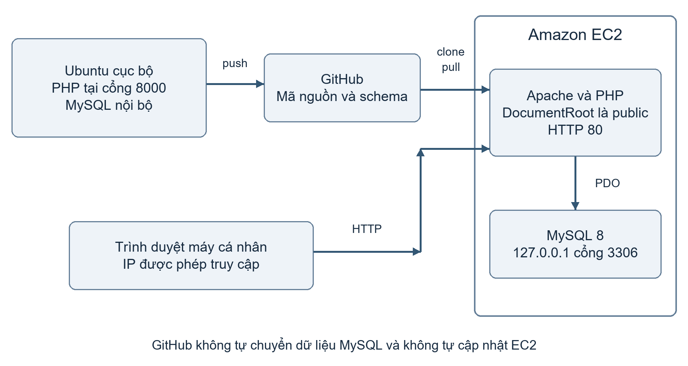

# Ứng dụng PHP quản lý công việc nhóm với MySQL GitHub và Amazon EC2
Tài liệu thực hành dành cho sinh viên đã biết HTML, PHP cơ bản và câu lệnh SQL. Sinh viên chạy ứng dụng trên Ubuntu cục bộ, quản lý các lần sửa bằng GitHub, rồi triển khai cùng mã nguồn lên một máy EC2 Ubuntu. Máy cục bộ có thể là máy ảo Ubuntu chạy trên Windows.
Ứng dụng phục vụ một project cố định mang tên Website giới thiệu khoa. Người dùng thêm thành viên, giao việc, sửa nội dung, cập nhật trạng thái, xem việc quá hạn và lọc danh sách. Bài lab dùng một giao diện chung, chưa có tài khoản đăng nhập hoặc phân quyền theo thành viên.
## Kết quả cần đạt
- Tạo được ứng dụng PHP kết nối MySQL qua PDO và thực hiện các thao tác thêm, xem, sửa, xóa.
- Tạo repository GitHub và ít nhất hai commit có nội dung rõ ràng.
- Truy cập ứng dụng trên EC2 từ trình duyệt và cập nhật phiên bản bằng git pull.
- Giải thích được vì sao mã nguồn, cấu hình mật khẩu và dữ liệu MySQL phải được quản lý riêng.
## Phạm vi thực hành
Thời lượng dự kiến 3 buổi, mỗi buổi 2 tiết. Dùng dữ liệu giả. Bản thực hành chưa có đăng nhập và HTTPS nên chỉ mở HTTP cho địa chỉ IP của người thực hiện. Không dùng bản này để lưu dữ liệu thật của lớp hoặc cung cấp dịch vụ công khai.
| Thành phần | Lựa chọn trong bài |
|---|---|
| Máy cục bộ | Ubuntu Desktop hoặc Server 24.04 LTS trên máy thật hoặc máy ảo, RAM từ 2 GB |
| Phần mềm | PHP 8.3 từ kho Ubuntu, MySQL 8, Apache 2, Git |
| AWS | Một EC2 Ubuntu Server 24.04 LTS x86 64, t3.small, ổ gp3 16 GiB |
| GitHub | Repository chứa mã nguồn và cấu trúc bảng, không chứa mật khẩu hoặc dữ liệu thật |
| Tệp đi kèm | Ma_nguon_PHP_Quan_ly_cong_viec_GitHub_EC2.zip |
Gói phần mềm trên Ubuntu có thể đổi số bản vá. Cập nhật từ kho chính thức trước khi chạy. Kiểu máy và dung lượng đề xuất là cho bài lab, không phải cam kết thuộc Free Tier.

# 1 Sơ đồ và cách hoạt động

Trên máy cục bộ, PHP chạy bằng máy chủ phát triển tại 127.0.0.1 cổng 8000; MySQL chạy cùng máy. Mỗi lần gửi biểu mẫu, PHP kiểm tra dữ liệu rồi ghi vào CSDL bằng câu lệnh có tham số.
GitHub giữ các phiên bản mã nguồn. Trên EC2, người thực hiện dùng git clone để lấy mã nguồn, cài Apache và PHP rồi tạo một CSDL riêng. Các dòng dữ liệu đã nhập trên máy cục bộ không tự xuất hiện trên EC2.
Trình duyệt truy cập EC2 qua HTTP cổng 80. Apache chỉ phục vụ thư mục public. Thư mục config, database và .git nằm ngoài vùng web. MySQL chỉ nhận kết nối nội bộ; không thêm quy tắc mở cổng 3306 trong Security Group.
## Quy trình triển khai
1. Viết và chạy thử mã nguồn trên máy cục bộ.
2. Tạo commit, kiểm tra tệp được theo dõi rồi đẩy lên GitHub.
3. Tạo EC2, lấy mã nguồn từ GitHub và cấu hình PHP với MySQL.
4. Sửa một chi tiết trên máy cục bộ, commit và push; vào EC2 thực hiện git pull để cập nhật.
PHP trong bài này không có bước biên dịch hoặc npm build. Triển khai gồm cài môi trường chạy, lấy mã nguồn, cấu hình kết nối và khởi tạo CSDL.

# 2 Chuẩn bị mã nguồn và CSDL
Giải nén gói đi kèm. Thư mục php_team_project là thư mục dự án. Khi chuyển sang Ubuntu, có thể dùng thư mục chia sẻ của máy ảo hoặc tải gói ZIP vào Ubuntu rồi giải nén. Không sửa trực tiếp trong tệp ZIP.
## Cấu trúc dự án
```
php_team_project/
  public/index.php          Giao diện và xử lý biểu mẫu
  public/assets/style.css   Định dạng giao diện
  src/bootstrap.php         Phiên làm việc và kết nối PDO
  config/config.example.php Mẫu cấu hình không có mật khẩu thật
  database/schema.sql       Cấu trúc bảng
  deploy/team-project.conf  Cấu hình Apache cho EC2
  .gitignore                Loại cấu hình riêng khỏi Git
  README.md                 Hướng dẫn chạy nhanh
```
Tệp config/config.local.php được tạo riêng trên mỗi máy và bị .gitignore loại khỏi Git. Chỉ public được dùng làm DocumentRoot. Không đặt cả thư mục dự án trong vùng web mặc định /var/www/html.
## Thiết kế CSDL
| Bảng | Trường chính | Ý nghĩa |
|---|---|---|
| members | id, name, email | Thành viên, email không được trùng |
| tasks | id, title, description | Nội dung công việc |
| tasks | member_id, due_date, status | Người làm, hạn hoàn thành và trạng thái |
Quan hệ members 1 đến nhiều tasks được khai báo bằng khóa ngoại. Không xóa được thành viên đang có công việc. Hãy chuyển công việc sang người khác hoặc xóa công việc trước khi xóa thành viên.
Ba giá trị trạng thái là todo, doing và done. Giao diện hiển thị Chưa làm, Đang làm và Hoàn thành. Một việc có hạn nhỏ hơn ngày hiện tại và chưa hoàn thành được đánh dấu Quá hạn.
## Bài tập đọc mã nguồn
Mở public/index.php, xác định nhánh save_member, save_task và delete_task. Mở src/bootstrap.php để tìm phần tạo PDO, hàm thoát HTML và token CSRF. Không thay câu lệnh có tham số bằng cách ghép dữ liệu nhập vào chuỗi SQL.

# 3 Cài môi trường trên máy cục bộ
Các lệnh trong phần này chạy trong Terminal của Ubuntu cục bộ, không chạy trong PowerShell của Windows và chưa chạy trên EC2. Chuyển vào thư mục dự án trước khi thực hiện các lệnh dùng đường dẫn tương đối.
## Bước 1 Cài PHP MySQL và Git
```
sudo apt update
sudo apt install -y php-cli php-mysql mysql-server git unzip
sudo systemctl enable --now mysql
php -v
php -m | grep -Ei 'PDO|pdo_mysql'
mysql --version
```
Kết quả cần có PHP 8.3, PDO, pdo_mysql và MySQL. Máy chủ phát triển PHP dùng cho bước thử cục bộ nên chưa cần Apache. Nếu đang dùng Windows và đã cài XAMPP, lưu ý dịch vụ có nhãn MySQL trong XAMPP thường là MariaDB; bài hướng dẫn chính sử dụng MySQL trên Ubuntu để thống nhất với EC2.
## Bước 2 Tạo CSDL và tài khoản ứng dụng
Chạy sudo mysql, sau đó nhập các câu SQL bên dưới. Thay MatKhauRieng_CucBo_2026 bằng mật khẩu riêng, chỉ dùng chữ, số và ký tự phù hợp với chuỗi SQL; không đưa mật khẩu thật vào báo cáo.
```
sudo mysql
```
```
CREATE DATABASE team_project
 CHARACTER SET utf8mb4 COLLATE utf8mb4_unicode_ci;
CREATE USER 'team_app'@'127.0.0.1'
 IDENTIFIED BY 'MatKhauRieng_CucBo_2026';
GRANT SELECT, INSERT, UPDATE, DELETE ON team_project.*
 TO 'team_app'@'127.0.0.1';
EXIT;
```
Tài khoản team_app chỉ được đọc và thay đổi dữ liệu. Việc tạo bảng dùng quyền quản trị trong bước tiếp theo; ứng dụng không cần quyền CREATE hoặc DROP.
## Bước 3 Nhập cấu trúc bảng
Trong Terminal, vào thư mục php_team_project rồi thực hiện:
```
sudo mysql team_project < database/schema.sql
sudo mysql -e "SHOW TABLES FROM team_project;"
```
Kết quả có members và tasks. Chỉ nhập schema.sql một lần vào CSDL trống. Nếu đã có bảng, không xóa CSDL để xử lý lỗi; kiểm tra đang chọn đúng CSDL trước.

# 4 Chạy thử và sử dụng ứng dụng
## Bước 4 Tạo cấu hình cục bộ
```
cp config/config.example.php config/config.local.php
nano config/config.local.php
```
Giữ host là 127.0.0.1, database là team_project, username là team_app. Thay giá trị password bằng mật khẩu đã đặt ở bước 2. Cấu hình trả về một mảng PHP; giữ nguyên dấu nháy, dấu phẩy và dấu chấm phẩy.
```
chmod 600 config/config.local.php
php -S 127.0.0.1:8000 -t public
```
Mở trình duyệt bên trong Ubuntu và truy cập http://127.0.0.1:8000. Với Ubuntu Server trên máy ảo không có trình duyệt, dùng SSH chuyển tiếp cổng từ máy Windows như hướng dẫn dưới đây. Không đổi sang 0.0.0.0 chỉ để mở ứng dụng cho cả mạng.
```
ssh -L 8000:127.0.0.1:8000 USER_UBUNTU@IP_MAY_AO
```
Giữ cửa sổ SSH mở, chạy máy chủ PHP trong một phiên Ubuntu khác, rồi mở http://127.0.0.1:8000 trên Windows. Thay USER_UBUNTU và IP_MAY_AO bằng tài khoản và địa chỉ máy ảo; máy ảo cần dịch vụ SSH và kết nối mạng phù hợp. Có thể dùng Ubuntu Desktop để bỏ qua bước chuyển tiếp này.
## Bước 5 Nhập dữ liệu giả
| Thành viên | Email giả | Công việc được giao |
|---|---|---|
| Nguyễn An | an@example.com | Thiết kế trang chủ |
| Trần Bình | binh@example.com | Viết trang giới thiệu |
| Lê Chi | chi@example.com | Kiểm thử biểu mẫu liên hệ |
Thêm ba thành viên trước. Sau đó thêm ba công việc; mỗi việc có tiêu đề, mô tả, người làm và hạn hoàn thành. Chọn một việc có hạn là ngày hôm qua để thử nhãn Quá hạn. Đổi một việc từ Chưa làm sang Đang làm rồi Hoàn thành.
Chọn các liên kết trạng thái để lọc danh sách. Chọn Sửa để nạp lại dữ liệu vào biểu mẫu. Nút Xóa thực hiện xóa ngay sau khi gửi biểu mẫu; chỉ thao tác trên dữ liệu thử.
## Bước 6 Kiểm tra dữ liệu đã lưu
```
mysql -h 127.0.0.1 -u team_app -p team_project
```
```
SELECT id,name,email FROM members;
SELECT id,title,member_id,status FROM tasks;
EXIT;
```
Dừng máy chủ PHP bằng Ctrl C rồi chạy lại và tải lại trang. Dữ liệu phải còn vì được lưu trong MySQL, không nằm trong phiên làm việc của PHP.

# 5 Đưa mã nguồn lên GitHub
Các bước Git thực hiện tại Ubuntu cục bộ trong thư mục php_team_project. Thay TEN_GITHUB, email và địa chỉ repository bằng thông tin của người thực hiện. Tệp .gitignore đã có sẵn trong gói mã nguồn.
## Bước 7 Khởi tạo Git và kiểm tra tệp
```
git init -b main
git config user.name "Ho ten sinh vien"
git config user.email "EMAIL_CUA_BAN"
git add .
git status
git check-ignore config/config.local.php
git diff --cached --stat
```
git check-ignore phải in ra config/config.local.php. Dùng git diff --cached để xem nội dung sắp commit, bảo đảm không có mật khẩu, tệp khóa .pem hoặc bản sao dữ liệu thật. Không đặt khóa EC2 trong thư mục dự án.
```
git diff --cached
git commit -m "Tao ung dung quan ly cong viec PHP MySQL"
```
## Bước 8 Tạo repository trên trang GitHub
Đăng nhập GitHub, chọn dấu cộng rồi New repository. Đặt tên team-project-php. Với bài lab dữ liệu giả, có thể chọn Public để EC2 lấy mã nguồn mà không cần khóa truy cập GitHub. Không chọn tạo README, .gitignore hoặc License ở bước này vì dự án cục bộ đã có tệp. Chọn Create repository.
```
git remote add origin https://github.com/TEN_GITHUB/team-project-php.git
git push -u origin main
```
GitHub không nhận mật khẩu tài khoản khi Git hỏi mật khẩu HTTPS. Dùng GitHub CLI theo tài liệu chính thức ở cuối bài, hoặc tạo fine grained personal access token giới hạn đúng repository, quyền Contents Read and write và ngày hết hạn ngắn. Nhập token tại lời nhắc Password; không viết token trong URL hoặc câu lệnh, không chụp màn hình token. Khi nhập mật khẩu hoặc token, Terminal có thể không hiển thị ký tự.
## Bước 9 Kiểm tra trên web
Mở repository và xác nhận có public, src, database, deploy và config/config.example.php. Không được có config/config.local.php. Chọn Commits để xem commit đầu tiên. Nếu lỡ đẩy mật khẩu lên GitHub, đổi mật khẩu ngay; xóa tệp trong commit sau không xóa bí mật khỏi lịch sử Git.
Với repository Private, EC2 cần cơ chế xác thực riêng, chẳng hạn deploy key chỉ đọc. Phần triển khai chính bên dưới dùng repository Public đã loại cấu hình bí mật; không đưa token cá nhân lên EC2 để làm theo nhanh.

# 6 Tạo máy chủ EC2 trên AWS Console
## Bước 10 Chọn Region và tạo instance
Đăng nhập AWS Console, chọn một Region dùng xuyên suốt bài, chẳng hạn Asia Pacific Singapore. Mở EC2, chọn Instances, Launch instances. Các nhãn giao diện có thể thay đổi; đối chiếu mục có cùng chức năng nếu tài khoản hiển thị khác.
| Trường | Giá trị hoặc thao tác |
|---|---|
| Name | team-project-php-lab |
| Application and OS Images | Ubuntu Server 24.04 LTS của Canonical, kiến trúc 64 bit x86 |
| Instance type | t3.small, RAM 2 GiB cho Apache PHP và MySQL cùng máy |
| Key pair | Create new key pair, RSA, định dạng pem; tải về và giữ riêng |
| Network | VPC mặc định nếu có, subnet có đường ra Internet qua Internet Gateway |
| Auto assign public IP | Enable |
| Storage | 16 GiB gp3, xem tùy chọn Delete on termination |
Nếu không có VPC mặc định, nhờ giảng viên chuẩn bị VPC với public subnet và route 0.0.0.0/0 đến Internet Gateway. Bài này không tạo NAT Gateway hoặc Load Balancer.
## Bước 11 Cấu hình Security Group
Tạo nhóm team-project-php-sg với hai quy tắc inbound. Chọn nguồn My IP cho từng quy tắc; nếu cần nhập tay, dùng IP public hiện tại kèm /32. Không dùng IP riêng của máy trong mạng nội bộ.
| Loại | Cổng | Nguồn |
|---|---|---|
| SSH | TCP 22 | My IP của người thực hiện |
| HTTP | TCP 80 | My IP của người thực hiện |
Không thêm MySQL 3306. Giữ outbound mặc định trong bài để cài gói và lấy mã nguồn. Chọn Launch instance, chờ Running và các Status checks báo đạt. Ghi lại Public IPv4 address.
## Bước 12 Kết nối từ máy cá nhân
Mở Terminal trên Ubuntu hoặc PowerShell có OpenSSH trên Windows. Lệnh chmod chỉ dùng trong Ubuntu; trên Windows bảo vệ tệp pem bằng quyền tệp của tài khoản hiện tại, làm theo hướng dẫn SSH của AWS nếu công cụ báo quyền quá rộng.
```
chmod 400 /DUONG_DAN/team-project-key.pem
ssh -i /DUONG_DAN/team-project-key.pem ubuntu@EC2_PUBLIC_IP
```
Thay toàn bộ chỗ giữ chỗ bằng đường dẫn và IP thật. Với AMI Ubuntu, tên tài khoản SSH là ubuntu. Các lệnh ở phần tiếp theo chạy trong phiên SSH của EC2.

# 7 Cài ứng dụng và MySQL trên EC2
## Bước 13 Cài môi trường chạy
```
sudo apt update
sudo apt install -y apache2 php libapache2-mod-php php-mysql mysql-server git
sudo systemctl enable --now apache2 mysql
php -v
php -m | grep -Ei 'PDO|pdo_mysql'
```
## Bước 14 Lấy mã nguồn từ GitHub
```
sudo mkdir -p /var/www/team-project
sudo chown ubuntu:ubuntu /var/www/team-project
git clone https://github.com/TEN_GITHUB/team-project-php.git /var/www/team-project
cd /var/www/team-project
git log -1 --oneline
```
Nếu clone báo thư mục không rỗng, kiểm tra nội dung trước. Không xóa thư mục chứa phiên bản đang chạy. Ghi lại mã commit để đối chiếu với GitHub.
## Bước 15 Tạo CSDL riêng trên EC2
Chạy sudo mysql và nhập các câu sau. Đặt mật khẩu khác với máy cục bộ, thay MatKhauRieng_EC2_2026 bằng mật khẩu riêng. Không đưa mật khẩu vào code đã commit.
```
sudo mysql
```
```
CREATE DATABASE team_project
 CHARACTER SET utf8mb4 COLLATE utf8mb4_unicode_ci;
CREATE USER 'team_app'@'127.0.0.1'
 IDENTIFIED BY 'MatKhauRieng_EC2_2026';
GRANT SELECT, INSERT, UPDATE, DELETE ON team_project.*
 TO 'team_app'@'127.0.0.1';
EXIT;
```
```
sudo mysql team_project < database/schema.sql
cp config/config.example.php config/config.local.php
nano config/config.local.php
```
Điền mật khẩu vừa tạo; giữ host 127.0.0.1 và tên CSDL team_project. Dữ liệu cục bộ không được chuyển qua GitHub. Trong bài lab, nhập lại ba thành viên và các công việc giả trên EC2 sau khi truy cập được web.
## Bước 16 Giới hạn quyền đọc cấu hình
```
sudo chown ubuntu:www-data config/config.local.php
sudo chmod 640 config/config.local.php
sudo mysql -e "SHOW VARIABLES LIKE 'bind_address';"
```
bind_address nên là 127.0.0.1 để chỉ nhận kết nối nội bộ. Nếu khác, mở /etc/mysql/mysql.conf.d/mysqld.cnf, đặt bind-address = 127.0.0.1 trong mục mysqld rồi khởi động lại MySQL. Không đổi sang 0.0.0.0 để chữa lỗi kết nối PHP.

# 8 Cấu hình Apache và kiểm tra web
## Bước 17 Bật VirtualHost của ứng dụng
```
cd /var/www/team-project
sudo cp deploy/team-project.conf /etc/apache2/sites-available/team-project.conf
sudo a2dissite 000-default.conf
sudo a2ensite team-project.conf
sudo apache2ctl configtest
sudo systemctl reload apache2
```
Chỉ reload khi configtest báo Syntax OK. Cấu hình đi kèm đặt DocumentRoot là /var/www/team-project/public và tắt liệt kê thư mục. Không dùng thư mục gốc của Git làm DocumentRoot.
## Bước 18 Kiểm tra tại EC2 và trình duyệt
```
curl -I http://127.0.0.1/
curl -I http://127.0.0.1/config/config.local.php
curl -I http://127.0.0.1/.git/config
```
Trang chủ cần trả HTTP 200 khi CSDL đã sẵn sàng. Hai URL còn lại phải trả 404 hoặc bị chặn; không được trả nội dung cấu hình. Trên máy cá nhân, mở http://EC2_PUBLIC_IP. Trình duyệt có thể báo kết nối HTTP chưa mã hóa; bài lab chỉ dùng dữ liệu giả và nguồn truy cập giới hạn IP.
Thêm thành viên, giao việc, sửa trạng thái và tải lại trang. Xác nhận số lượng trên đầu trang thay đổi đúng. Khởi động lại Apache rồi xem dữ liệu vẫn còn. Chụp giao diện và màn hình SQL chỉ chứa dữ liệu giả.
## Khi web không truy cập được
Kiểm tra instance Running, Public IPv4, HTTP 80 và IP nguồn trong Security Group. Khi chuyển Wi Fi hoặc mạng 4G, IP public có thể đổi; cập nhật My IP cho cả HTTP và SSH. Kiểm tra Apache đang chạy và subnet có route ra Internet. Nếu đã bật UFW, cho phép OpenSSH trước khi điều chỉnh tường lửa và chỉ mở HTTP cho IP được phép.
```
sudo systemctl status apache2 mysql --no-pager
sudo tail -n 40 /var/log/apache2/team-project-error.log
```
## Khi không kết nối được CSDL
Kiểm tra cấu hình trên EC2, mật khẩu, tên CSDL và pdo_mysql. Dùng lệnh dưới để thử đúng tài khoản ứng dụng, nhập mật khẩu tại lời nhắc:
```
mysql -h 127.0.0.1 -u team_app -p team_project
```
Không dùng root để thay cho team_app trong cấu hình PHP. Nếu báo thiếu bảng, kiểm tra SHOW TABLES và việc đã nhập schema.sql vào đúng CSDL.

# 9 Cập nhật phiên bản qua GitHub
## Bước 19 Sửa ứng dụng trên máy cục bộ
Trong public/index.php, đổi APP_VERSION từ 1.0.0 thành 1.1.0. Có thể đổi tên project cố định trên phần đầu giao diện. Chạy lại ứng dụng cục bộ để kiểm tra rồi tạo commit thứ hai.
```
git diff
git add public/index.php
git commit -m "Cap nhat ten project va phien ban 1.1.0"
git push origin main
git log -2 --oneline
```
## Bước 20 Cập nhật trên EC2
Trong phiên SSH của EC2:
```
cd /var/www/team-project
git status --short
git pull --ff-only origin main
php -l public/index.php
git log -1 --oneline
sudo systemctl reload apache2
```
Nếu có tệp được theo dõi đã sửa trên EC2, dừng cập nhật để xem git diff. Không dùng git reset --hard để xóa thay đổi một cách máy móc. Tệp config.local.php được bỏ qua nên cấu hình riêng trên EC2 vẫn giữ nguyên.
Tải lại trang và xem Phiên bản 1.1.0. Đối chiếu mã commit ở EC2 với commit mới nhất trên GitHub. Các thành viên và công việc đã tạo trên EC2 vẫn phải còn.
Chỉ push lên GitHub chưa làm EC2 thay đổi. Bài này triển khai thủ công bằng git pull. Không nhập lại schema.sql khi cập nhật giao diện vì bảng đã tồn tại. Thay đổi CSDL trong các phiên bản sau cần có tập lệnh chuyển đổi riêng và sao lưu trước khi chạy.
## Sao lưu trong lúc làm bài
Nếu cần giữ dữ liệu trước khi kết thúc, xuất bằng quyền quản trị MySQL trên EC2. Tệp sao lưu nằm trong thư mục home, ngoài thư mục Git.
```
sudo mysqldump --single-transaction --no-tablespaces team_project > ~/team-project-backup.sql
chmod 600 ~/team-project-backup.sql
```
Tải tệp về máy cá nhân bằng scp trong Terminal của máy cá nhân. Không thực hiện lệnh này trong phiên SSH EC2:
```
scp -i /DUONG_DAN/team-project-key.pem ubuntu@EC2_PUBLIC_IP:team-project-backup.sql ./
```
Không commit bản sao lưu có dữ liệu cá nhân. Bài này không yêu cầu nhập lại bản sao lưu vào máy khác.

# 10 Kiểm thử và bài tập
Thực hiện các trường hợp sau ở cả cục bộ và EC2. Ghi Đạt hoặc Chưa đạt và bằng chứng tương ứng. Bảng này là phiếu kiểm thử cho sinh viên, không phải xác nhận hệ thống AWS đã được chạy sẵn.
| Mã | Thao tác | Kết quả cần có |
|---|---|---|
| T01 | Thêm ba thành viên với email khác nhau | Ba thành viên xuất hiện |
| T02 | Thêm thành viên có email trùng | Báo lỗi, không tạo bản ghi trùng |
| T03 | Giao việc cho một thành viên | Danh sách hiển thị đúng người và hạn |
| T04 | Sửa nội dung và đổi trạng thái | Nội dung và bộ đếm thay đổi đúng |
| T05 | Tạo việc quá hạn và chưa hoàn thành | Hiển thị Quá hạn |
| T06 | Lọc từng trạng thái | Chỉ hiện các việc tương ứng |
| T07 | Xóa thành viên còn công việc | Bị từ chối bởi ràng buộc dữ liệu |
| T08 | Chuyển việc sang người khác rồi xóa thành viên | Xóa được, việc vẫn còn |
| T09 | Nhập tiêu đề chứa thẻ script | Hiển thị như văn bản, không chạy mã |
| T10 | Gửi POST không có token CSRF hợp lệ | HTTP 403, không thay đổi dữ liệu |
| T11 | Dừng và chạy lại PHP hoặc Apache | Dữ liệu MySQL còn nguyên |
| T12 | Truy cập URL cấu hình và .git trên EC2 | Không lộ tệp ngoài public |
| T13 | Push commit thứ hai rồi pull trên EC2 | Phiên bản đổi, dữ liệu giữ nguyên |
Để thử T10 tại máy cục bộ khi máy chủ PHP đang chạy, dùng lệnh dưới. Lệnh không có token nên phải bị từ chối trước khi thêm thành viên.
```
curl -i -X POST http://127.0.0.1:8000/index.php \
 -d 'action=save_member&name=Test&email=test@example.com'
```
## Bài tập mở rộng
- Bổ sung bộ lọc theo thành viên bằng câu lệnh có tham số.
- Thêm bảng projects và liên kết tasks với từng project.
- Thêm tài khoản, đăng nhập và phân quyền để mỗi thành viên chỉ cập nhật việc được giao. Cần kiểm tra quyền ở máy chủ trong mỗi thao tác.
Trước khi mở cho người dùng thật, cần hoàn thành đăng nhập, phân quyền, HTTPS và quy trình sao lưu. Token CSRF và giới hạn IP trong bài không thay cho kiểm tra quyền người dùng.

# 11 Nộp bài chi phí và thu hồi tài nguyên
## Hồ sơ nộp bài
- Đường dẫn repository, mã của hai commit và mô tả phần đã sửa.
- Ảnh chạy cục bộ, ảnh chạy EC2 và bảng kiểm thử đã điền.
- Sơ đồ máy cục bộ, GitHub, Apache PHP và MySQL trên EC2.
- Giải thích vì sao không đưa mật khẩu vào Git và vì sao push chưa tự cập nhật EC2.
- Ảnh đã terminate instance hoặc ghi nhận thời điểm dừng lab; che thông tin tài khoản và không gửi khóa pem.
| Nội dung | Điểm |
|---|---|
| Chạy cục bộ, tạo bảng và kết nối MySQL đúng | 2 |
| Thêm sửa xóa và giao việc đúng | 2 |
| GitHub có hai commit, không lộ cấu hình riêng | 2 |
| EC2 truy cập được, DocumentRoot và Security Group đúng | 2 |
| Cập nhật giữ dữ liệu, kiểm thử và dọn tài nguyên | 2 |
## Chi phí và kết thúc bài lab
EC2, EBS và IPv4 public có thể phát sinh phí. t3.small không được mặc định xem là miễn phí; mức phí tùy Region và điều kiện tài khoản. Kiểm tra Billing and Cost Management và bảng giá AWS trước khi tạo. Budget giúp theo dõi, không phải giới hạn cứng ngăn mọi khoản phí.
Sau khi lưu bằng chứng và sao lưu nếu cần, mở EC2, chọn instance rồi Instance state, Terminate delete instance. Xác nhận đúng tên và ID của máy lab. Dữ liệu trong ổ sẽ mất nếu ổ được cấu hình xóa cùng instance.
Kiểm tra Volumes và Snapshots để phát hiện tài nguyên lab còn giữ lại. Chỉ xóa tài nguyên đúng của bài lab. Nếu đã tự cấp Elastic IP, release khi không dùng. Xóa Security Group và key pair riêng của lab khi không còn gắn với tài nguyên khác. Xóa key pair trên AWS không xóa tệp pem đã tải về máy.
Stop instance chỉ dừng máy; EBS và các tài nguyên còn giữ có thể tiếp tục tính phí. Sau terminate, kiểm tra trang Billing có độ trễ cập nhật. Không xóa repository GitHub nếu còn dùng để chấm bài.
## Ghi chú về xác minh tài liệu
Mã nguồn được cung cấp để sinh viên triển khai theo các bước. Các kiểm tra tự động đi kèm tập trung vào cú pháp PHP và luồng xử lý với CSDL thử nghiệm; môi trường MySQL và AWS của lớp cần được giảng viên chạy thử trước buổi học. Không coi việc tạo được tài liệu hoặc ZIP là bằng chứng đã triển khai EC2 thành công.

# 12 Tài liệu tham khảo
Các nguồn dưới đây dùng để đối chiếu cài đặt PHP MySQL, đưa mã lên GitHub và tạo EC2. Ngày đối chiếu 26 tháng 10 năm 2026. Khi giao diện dịch vụ thay đổi, dùng tài liệu chính thức theo chức năng tương ứng.
## Ubuntu và PHP
Hướng dẫn cài PHP với Apache và MySQL trên Ubuntu
https://ubuntu.com/server/docs/programming-php/
Hướng dẫn cài MySQL trên Ubuntu
https://ubuntu.com/server/docs/databases-mysql/
PDO prepare và câu lệnh có tham số
https://www.php.net/manual/en/pdo.prepare.php
## GitHub
Đưa mã nguồn cục bộ lên GitHub
https://docs.github.com/en/migrations/importing-source-code/using-the-command-line-to-import-source-code/adding-locally-hosted-code-to-github
Quản lý personal access token
https://docs.github.com/en/authentication/keeping-your-account-and-data-secure/managing-your-personal-access-tokens
GitHub CLI và xác thực trên máy cục bộ
https://cli.github.com/manual/gh_auth_login
## Amazon EC2
Tạo và kết nối một EC2 instance thử nghiệm
https://docs.aws.amazon.com/AWSEC2/latest/UserGuide/tutorial-launch-a-test-ec2-instance.html
Tạo Security Group
https://docs.aws.amazon.com/AWSEC2/latest/UserGuide/creating-security-group.html
Kết nối EC2 Linux bằng SSH
https://docs.aws.amazon.com/AWSEC2/latest/UserGuide/connect-to-linux-instance.html
Bảng giá EC2 theo nhu cầu
https://aws.amazon.com/ec2/pricing/on-demand/
Trước buổi học, giảng viên nên chạy trọn quy trình ở tài khoản dành cho lớp, kiểm tra quota, loại máy có sẵn và quyền tạo EC2. Không yêu cầu sinh viên chia sẻ khóa truy cập AWS hoặc khóa SSH để được hỗ trợ.
